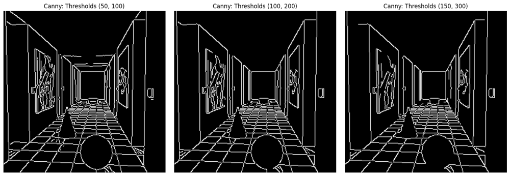
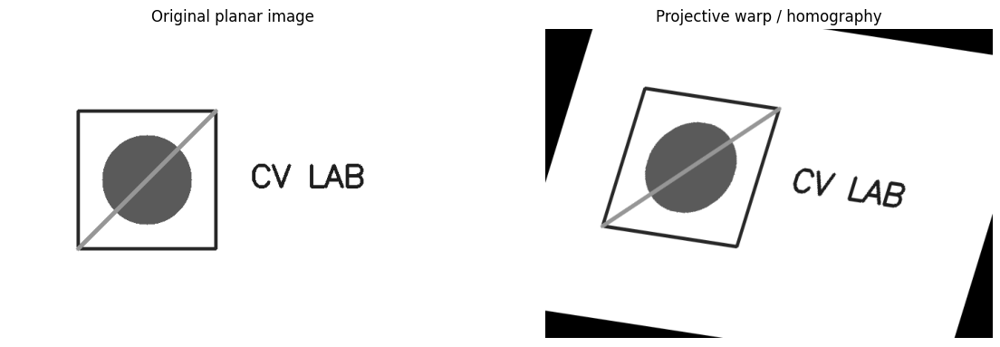
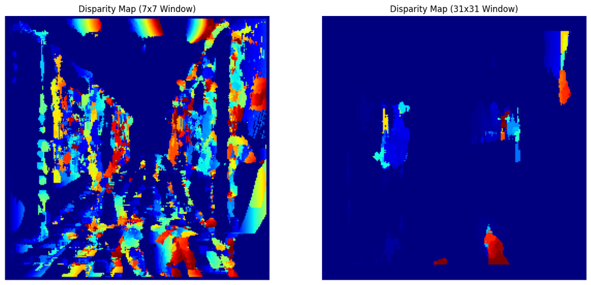
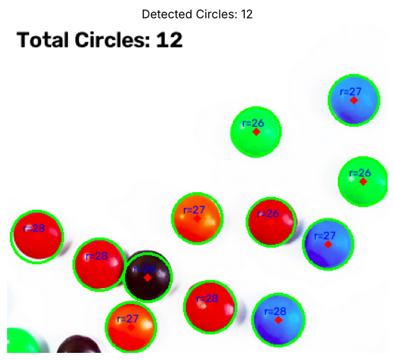
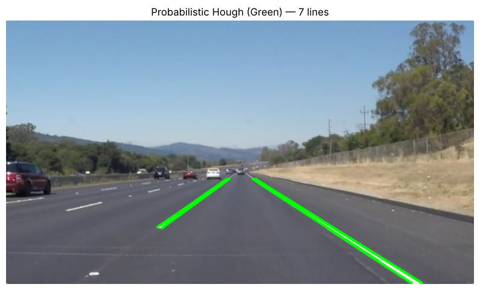
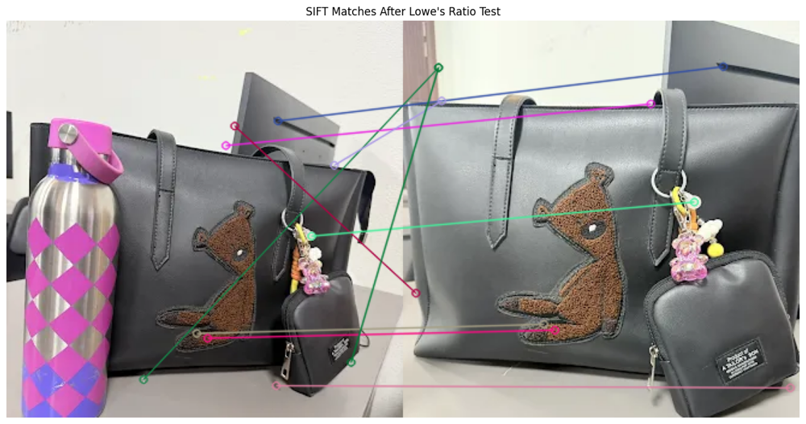
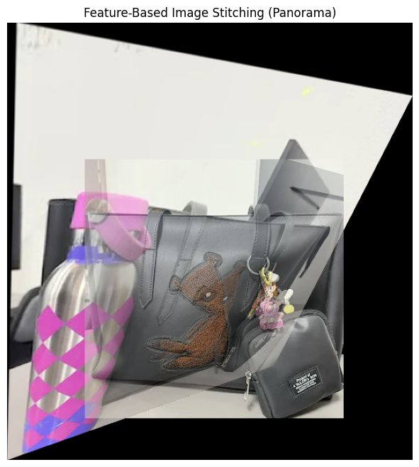
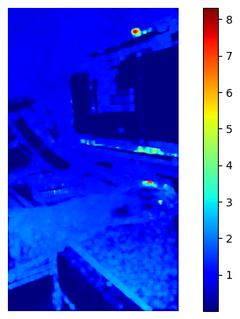

# Classical Computer Vision with OpenCV


Hands-on implementations of core image processing and geometric vision techniques: filtering, edge detection, geometric transforms, stereo depth, Hough transforms, feature matching, panorama stitching and optical flow. All notebooks are written in Python with OpenCV, NumPy and Matplotlib.

Coursework for Computer Vision, BSCS at Air University (Kharian Campus), Fall 2026.

> Deep learning work (CNNs, transfer learning, YOLO) is in the companion repo: [deep-learning-computer-vision](https://github.com/sarim0704/deep-learning-computer-vision).

## Projects

| # | Topic | Notebook | Key techniques |
|---|-------|----------|----------------|
| 01 | Image filtering and edge detection | [Image filtering](01-image-filtering-and-edge-detection/lab-task-1-image-filtering.ipynb) | Pixel shifting, custom 5×5 sharpening kernel, box / Gaussian / median filters, erosion, Sobel gradients |
| | | [Laplacian and Canny](01-image-filtering-and-edge-detection/lab-task-4-laplacian-and-canny-edges.ipynb) | Laplacian with and without Gaussian smoothing, Canny threshold comparison |
| 02 | Geometric transformations | [Geometric transformations](02-geometric-transformations/lab-2-geometric-transformations.ipynb) | Scaling, rotation, homogeneous coordinates, affine and projective (homography) warps |
| | | [Transformation order](02-geometric-transformations/lab-task-2-affine-transformation-order.ipynb) | Why the order of scale, rotate and translate changes the result |
| 03 | Stereo vision and depth | [Stereo matching](03-stereo-vision-and-depth/lab-task-3-stereo-matching-and-depth.ipynb) | Epipolar lines, SSD block matching, disparity maps, depth from disparity, effect of baseline and focal length |
| 04 | Hough transform | [Circles and lanes](04-hough-transform/assignment-1-hough-circles-and-lane-detection.ipynb) | `HoughCircles` object counting, road lane detection with `HoughLines` vs `HoughLinesP`, ROI masking |
| 05 | Features and image stitching | [Harris, SIFT, RANSAC, panorama](05-feature-detection-and-image-stitching/lab-6-harris-sift-ransac-panorama.ipynb) | Harris corners and scale invariance, SIFT keypoints, Lowe's ratio test, RANSAC homography, panorama stitching |
| 06 | Optical flow | [Optical flow](06-optical-flow/lab-optical-flow-lucas-kanade-and-farneback.ipynb) | Lucas-Kanade sparse flow, Farneback dense flow, flow magnitude visualisation on video |

## Results

### Edge detection: Canny at three thresholds


### Projective warp with a homography


### Stereo disparity maps (7×7 vs 31×31 window)


### Hough transform: circle detection and lane detection
<p>
  
  
</p>

### SIFT matching and panorama stitching
<p>
  
  
</p>

### Dense optical flow magnitude


## Getting started

Every notebook runs in Google Colab: open it on GitHub and click **Open in Colab**, or upload it at [colab.research.google.com](https://colab.research.google.com). Some notebooks ask you to upload your own image or video in the first cell.

To run locally:

```bash
git clone https://github.com/sarim0704/cv.git
cd cv
pip install -r requirements.txt
jupyter notebook
```

## Repository structure

```
├── 01-image-filtering-and-edge-detection/
├── 02-geometric-transformations/
├── 03-stereo-vision-and-depth/
├── 04-hough-transform/
├── 05-feature-detection-and-image-stitching/
├── 06-optical-flow/
├── assets/            # result images used in this README
└── requirements.txt
```

## Author

**Sarim Azhar**, BSCS student at Air University, interested in AI/ML and full stack development.
